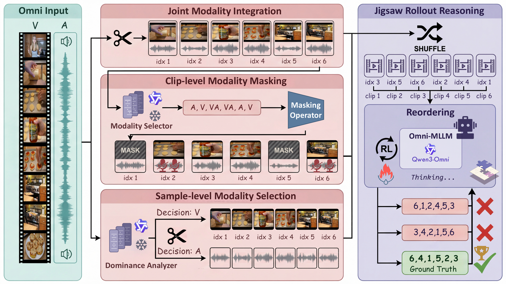

<div align="center">


<p align="center">
  
</p>

[Yiduo&nbsp;Jia](https://scholar.google.com/citations?user=oeqinEUAAAAJ&hl=zh-CN)<sup>1,&#42;</sup>, &nbsp; [Muzhi&nbsp;Zhu](https://scholar.google.com/citations?user=064gBH4AAAAJ&hl=zh-CN&oi=ao)<sup>1,&#42;</sup>, &nbsp; [Hao&nbsp;Zhong](https://scholar.google.com/citations?user=TnwXIMQAAAAJ&hl=zh-CN)<sup>1</sup>, &nbsp; [Mingyu&nbsp;Liu](https://mingyulau.github.io/)<sup>1</sup>, &nbsp; [Yuling&nbsp;Xi](https://scholar.google.com/citations?hl=zh-CN&user=5n05YgoAAAAJ&view_op=list_works&sortby=pubdate)<sup>1†</sup>, &nbsp; [Hao&nbsp;Chen](https://scholar.google.com/citations?user=FaOqRpcAAAAJ)<sup>1†</sup>,<br>
[Bin&nbsp;Qin](https://scholar.google.com/citations?hl=zh-CN&user=QaZ9uQ8AAAAJ)<sup>2</sup>, &nbsp; [Yongjie&nbsp;Yang](https://openreview.net/profile?id=~Yongjie_Yang3)<sup>2</sup>, &nbsp; [Zhenbo&nbsp;Luo](https://scholar.google.com/citations?user=Sh6y-_EAAAAJ&hl=zh-CN)<sup>2</sup>, &nbsp; [Chunhua&nbsp;Shen](https://cshen.github.io)<sup>1,3†</sup>

<sup>1</sup> [State Key Lab of CAD & CG, Zhejiang University](http://www.cad.zju.edu.cn/) &nbsp; <sup>2</sup> [Xiaomi&nbsp;Inc.](https://www.mi.com/global/) &nbsp; <sup>3</sup> [Ant&nbsp;Group](https://www.antgroup.com/en)<br>
<sup>&#42;</sup> Equal contributions &nbsp; <sup>†</sup> Corresponding authors

[&nbsp;**Paper**](https://arxiv.org/abs/2604.08209) &nbsp;|&nbsp; [&nbsp;**Project&nbsp;Page**](https://aim-uofa.github.io/OmniJigsaw/) &nbsp;|&nbsp; [&nbsp;**Dataset**](https://www.modelscope.cn/datasets/Jiayiduo/OmniJigsaw-8K "Dataset on ModelScope") &nbsp;|&nbsp; [&nbsp;**Dataset**](https://huggingface.co/datasets/zju/OmniJigsaw-8K "Dataset on Hugging Face")

</div>

## 🚀 Overview

<div align="center">
  <a href="docs/images/omnijigsaw_pipeline.png">
    
  </a>
</div>

**OmniJigsaw framework for self-supervised omni-modal RL post-training.** Three modality orchestration strategies are illustrated: Joint Modality Integration (JMI, top) exposing both audio-visual streams; Sample-level Modality Selection (SMS, bottom) prioritizing the primary informative modality; and Clip-level Modality Masking (CMM, center) imposing a clip-wise information bottleneck. All strategies share the same temporal reordering objective.

## 📖 Description

**OmniJigsaw** is a self-supervised reinforcement learning post-training framework built upon a temporal reordering proxy task. Centered on the chronological reconstruction of shuffled audio-visual clips, we successively investigate three modality orchestration strategies:

- **Joint Modality Integration (JMI)** retains the complete visual and auditory streams.
- **Sample-level Modality Selection (SMS)** selects the dominant modality through a global decision mechanism.
- **Clip-level Modality Masking (CMM)** adaptively masks modalities at the clip granularity.

Our analysis reveals a *bi-modal shortcut phenomenon* in JMI and demonstrates that CMM mitigates this issue by encouraging integration of fragmented visual and auditory cues. Incorporating lightweight puzzle-quality curation and verifiable rewards, OmniJigsaw enhances omni-modal reasoning without requiring human-annotated reasoning data. Across **15 video, audio, and omni-modal benchmarks**, CMM achieves the strongest overall performance among the three strategies. See the [project page](https://aim-uofa.github.io/OmniJigsaw/#results) for detailed results and analysis.

<a name="dataset"></a>

## 📊 Dataset

We release **OmniJigsaw-8K**, the curated dataset used for OmniJigsaw training.

| Resource | Downloads |
| :---: | :---: |
| <a name="omnijigsaw-8k"></a>**OmniJigsaw-8K** | <a name="modelscope-data"></a>[ModelScope](https://www.modelscope.cn/datasets/Jiayiduo/OmniJigsaw-8K)<br><a name="huggingface-data"></a>[Hugging&nbsp;Face](https://huggingface.co/datasets/zju/OmniJigsaw-8K) |

<a name="getting-started"></a>

## 🛠️ Getting Started

### 📐 Environment Setup

Use Linux x86-64 with a CUDA 12-compatible NVIDIA driver and [uv](https://docs.astral.sh/uv/getting-started/installation/) installed.

```bash
git clone https://github.com/aim-uofa/OmniJigsaw.git
cd OmniJigsaw
bash setup_env.sh
source .venv/bin/activate
```

The script creates a Python 3.12 environment, installs the bundled customized vLLM, downloads FlashAttention as needed, and applies the required compatibility patches.

### 📊 Data Preparation

Download **OmniJigsaw-8K** from the [resource links above](#dataset). Set `DATA_FOLDER` to the directory containing the three video folders:

```text
OmniJigsaw-8K/
├── finevideo_data/
├── nextqa_data/
└── youcook2_data/
```

Training and validation metadata for all three strategies are included in [`data/`](data/). Keep the directory structure and filenames unchanged so that the metadata resolves correctly.

OmniJigsaw-8K is the output of our data-curation pipeline and is ready for training. To curate additional data, see [`data_curation/README.md`](data_curation/README.md).

### 🏋️ Training

Download the official [Qwen3-Omni-30B-A3B-Instruct](https://huggingface.co/Qwen/Qwen3-Omni-30B-A3B-Instruct) base model and set the model and data paths:

```bash
export REF_MODEL_PATH=/path/to/Qwen3-Omni-30B-A3B-Instruct
export DATA_FOLDER=/path/to/OmniJigsaw-8K
```

Choose one of the three modality orchestration strategies to start training:

| Strategy | Command |
| :---: | :---: |
| JMI | `bash run_omnijigsaw_jmi.sh` |
| SMS | `bash run_omnijigsaw_sms.sh` |
| CMM | `bash run_omnijigsaw_cmm.sh` |

For example, launch CMM training with:

```bash
bash run_omnijigsaw_cmm.sh
```

The default recipes use **eight GPUs** and **1,000 GRPO steps**. Adjust GPU and batch settings in the corresponding launcher for your hardware. Checkpoints and logs are saved under `weights/<strategy>_qwen3_omni/<strategy>_qwen3_omni/`; set `SAVE_CHECKPOINT_DIR` to change the parent output directory. Each saved step includes a Hugging Face checkpoint at `global_step_<N>/actor/huggingface/` for evaluation.

### 🔍 Evaluation

To evaluate a post-trained model, specify the checkpoint path via `MODEL_PATH`. Prepare the evaluation datasets separately and configure their paths in [`benchmarks/run_omni_bench.sh`](benchmarks/run_omni_bench.sh), or override the corresponding `BENCHMARK_DIR_*` environment variables.

The evaluation suite supports the following benchmarks:

| Modality | Benchmarks |
| :---: | :---: |
| Video | [mlvu](https://huggingface.co/datasets/MLVU/MVLU), [mlvu_test_mcq](https://huggingface.co/datasets/MLVU/MLVU_Test), [video_mme](https://huggingface.co/datasets/lmms-eval/Video-MME), [video_holmes](https://huggingface.co/datasets/TencentARC/Video-Holmes),<br>[aot_bench](https://huggingface.co/datasets/sherryxzh/AoTBench), [tempcompass](https://huggingface.co/datasets/lmms-eval/TempCompass), [tuna_bench](https://huggingface.co/datasets/friedrichor/TUNA-Bench), [video_tt](https://huggingface.co/datasets/lmms-eval/video-tt) |
| Audio | [mmau_pro](https://huggingface.co/datasets/gamma-lab-umd/MMAU-Pro), [mmau_test_mini](https://huggingface.co/datasets/gamma-lab-umd/MMAU-test-mini), [mmsu](https://huggingface.co/datasets/ddwang2000/MMSU), [mmar](https://huggingface.co/datasets/BoJack/MMAR) |
| Omni-modal | [daily_omni](https://huggingface.co/datasets/liarliar/Daily-Omni), [intent_bench](https://huggingface.co/datasets/PhilipC/IntentBench), [omni_video_bench](https://huggingface.co/datasets/NJU-LINK/OmniVideoBench) |

For example, evaluate a CMM-trained checkpoint on Video-MME:

```bash
MODEL_PATH=/path/to/checkpoint \
BENCHMARK_DIR_VIDEOMME=/path/to/Video-MME \
CUDA_VISIBLE_DEVICES=0 \
bash benchmarks/run_omni_bench.sh cmm video_mme
```

The first argument sets the output tag; the optional second argument specifies the benchmark names, separated by commas. Once the dataset paths are configured, evaluate the model on multiple benchmarks with:

```bash
MODEL_PATH=/path/to/checkpoint \
bash benchmarks/run_omni_bench.sh cmm video_mme,mmar,omni_video_bench
```

Omit the second argument to evaluate all 15 benchmarks. Each launcher performs inference and scoring, saving predictions and reports to `benchmarks/<benchmark>/<tag>/`. Video evaluation uses audio by default; set `DISABLE_AUDIO=true` for inference without audio. GPU allocation can be configured through `CUDA_VISIBLE_DEVICES` and `TP_SIZE`.

## 🎫 License

The code is released under the Apache License 2.0, unless otherwise noted. See [LICENSE](LICENSE) and [NOTICE](NOTICE) for details.

## 🙏 Acknowledgements

Our implementation is built on [veRL](https://github.com/volcengine/verl), with data resources from [FineVideo](https://huggingface.co/datasets/HuggingFaceFV/finevideo), [LLaVA-Video-178K](https://huggingface.co/datasets/lmms-lab/LLaVA-Video-178K), and [YouCook2](https://youcook2.eecs.umich.edu/). We sincerely thank the contributors of these projects for their open-source work.

## 🖊️ Citation

If you find this work helpful for your research, please cite:

```bibtex
@misc{jia2026omnijigsawenhancingomnimodalreasoning,
  title={OmniJigsaw: Enhancing Omni-Modal Reasoning via Modality-Orchestrated Reordering},
  author={Yiduo Jia and Muzhi Zhu and Hao Zhong and Mingyu Liu and Yuling Xi and Hao Chen and Bin Qin and Yongjie Yang and Zhenbo Luo and Chunhua Shen},
  year={2026},
  eprint={2604.08209},
  archivePrefix={arXiv},
  primaryClass={cs.CV},
  url={https://arxiv.org/abs/2604.08209},
}
```
